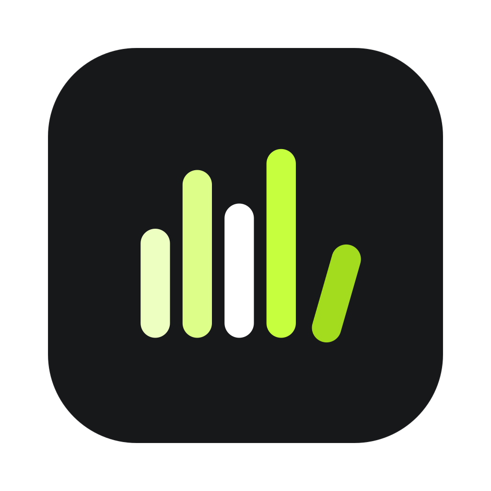
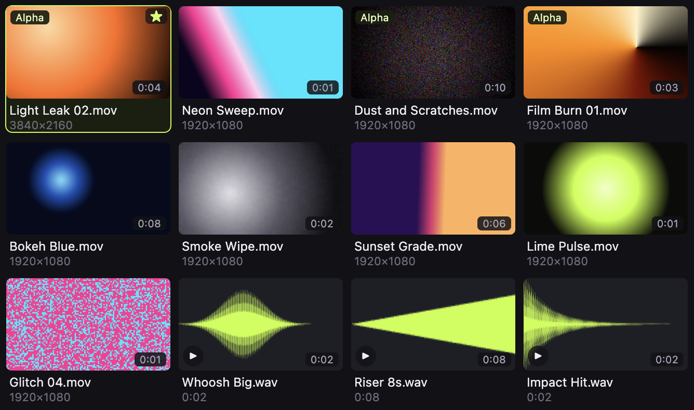

<p align="center">
  
</p>

<h1 align="center">Asset Library</h1>

<p align="center">
  <b>Every asset you own, one search away.</b><br />
  A free panel to search, preview and place your own transitions, overlays, sound effects, music,
  footage and images in Premiere Pro.
</p>

<p align="center">
  <a href="LICENSE"></a>
  <a href="https://github.com/saxenaxoxo/asset-library/releases/latest"></a>
  
  
</p>

<p align="center">
  
</p>
<p align="center"><sub>The asset grid with a demo library. Thumbnails are drawn by <code>pnpm screenshot</code>.</sub></p>

## Features

- **Search and preview inside Premiere Pro.** Thumbnails for footage and images, waveforms for audio,
  hover-scrub for video, and search across names, folders and tags, in a docked panel.
- **Place clips at the playhead.** Insert or overwrite at the playhead, or drag onto the timeline. The
  same file is never imported twice; later uses reuse it from an **Asset Library** bin.
- **Your folders and drives, kept up to date.** Asset Library indexes video, audio and images from the
  folders and external drives you add, in the background.
- **Your files stay where they are.** It never moves, renames, changes or deletes your files.
- **Local and private.** No account, no cloud library, no analytics. It works offline.
- **Favorites and tags.** Star what you reach for most and narrow the grid in one click.

## Install on a Mac

1. Download the `.dmg` for your Mac from the [latest release](https://github.com/saxenaxoxo/asset-library/releases/latest):
   `arm64` for Apple silicon (M1 and later), `x64` for Intel.
   Not sure? Apple menu → **About This Mac**: a Chip line starting with "Apple M" means Apple silicon.
2. Open the `.dmg` and drag **Goated Panels Hub** into Applications. The Hub is the installer and the
   background engine; it puts Asset Library into Premiere Pro.
3. Open Goated Panels Hub. The app isn't code-signed or notarized by Apple, so macOS blocks it the
   first time. To open it anyway ([Apple's guide](https://support.apple.com/guide/mac-help/open-a-mac-app-from-an-unknown-developer-mh40616/mac)):
   - Try to open it once, then close the warning.
   - Apple menu → **System Settings** → **Privacy & Security**.
   - Under Security, click **Open Anyway**, then enter your Mac password.

Windows: coming. A build exists but isn't released yet.

## Quick start

1. In Goated Panels Hub, on **Install**, keep **Premiere Pro** selected and click **Install Asset Library**.
2. Restart Premiere Pro and open **Window → Extensions → Asset Library**.
3. Add the folders or drives that hold your assets. Indexing runs in the background; thumbnails and
   waveforms appear as they're made.
4. Search, then double-click a tile (or press Enter) to place it at the playhead.

## Usage

| Do this                   | How                                                                                                      |
| ------------------------- | -------------------------------------------------------------------------------------------------------- |
| Find an asset             | Type in **Search** (`/` jumps there). It matches names, folders and tags. The type menu and ★ narrow it. |
| Preview                   | Hover a video to scrub it. Press **Space** to play a sound. Transparent clips show on a checkerboard.    |
| Place at the playhead     | Double-click, press **Enter**, or click **Add at playhead**. Choose **Insert** or **Overwrite**.         |
| Place several             | Shift-click or Cmd-click tiles, then **Enter**. They go in one after another.                            |
| Drag onto the timeline    | Drag any tile or file from the folder tree.                                                              |
| Import without placing    | **Import** adds it to the Asset Library bin only.                                                        |
| Favorite                  | Press **F** or click the star.                                                                           |
| Motion Graphics templates | `.mogrt` files are placed with Premiere's own template API.                                              |

More detail, including what Premiere's API does and doesn't allow, is in [docs/premiere-panel.md](docs/premiere-panel.md).

## Roadmap

- Windows release.
- A panel for After Effects (the Hub already has a tab for it).
- Signed installers, so macOS stops warning on first launch.

Ideas and bugs are tracked in [Issues](https://github.com/saxenaxoxo/asset-library/issues).

## FAQ

**Is it free?** Yes. Asset Library is free to use, and the code is MIT-licensed.

**Does it upload my files or track me?** No. There's no account and no analytics. Your library lives on
your Mac. The Hub contacts GitHub only to check for a newer version (optional, once a day) and to read
the panel download list when you open its window or install a panel. Nothing about you or your files is
sent.

**Which Premiere Pro versions work?** The panel is built for Premiere Pro 24 to 26 and tested on 26.5.
Premiere Pro 27 and later get a separate build that the Hub installs for you.

**Why does macOS warn me when I open it?** The app isn't signed or notarized by Apple yet. The steps
under [Install on a Mac](#install-on-a-mac) open it anyway.

**Where's my library stored?** In the app's own data folder on your Mac (under
`~/Library/Application Support/`). Uninstalling asks whether to keep it. Your own asset files are never touched.

**How do I uninstall?** In Goated Panels Hub, go to **Manage** → **Uninstall Goated Panels Hub…**.
Tick **Also delete my library** if you want that gone too.

## Contributing

Bug reports, ideas and pull requests are welcome. Read [CONTRIBUTING.md](CONTRIBUTING.md) to set up
the project and run the checks, and follow the [Code of Conduct](CODE_OF_CONDUCT.md). To report a
security problem privately, see [SECURITY.md](SECURITY.md).

<details>
<summary>Develop locally</summary>

Requires Node 22+ and pnpm 11. Run commands from the repository root.

```bash
pnpm install
pnpm dev          # run with hot reload
pnpm check        # typecheck + lint + unit tests
pnpm test:e2e     # launch the built app with Playwright
pnpm screenshot   # redraw docs/images/asset-grid.png
pnpm dist:mac     # unsigned .dmg into apps/desktop/dist/
```

| Path                   | What                                                                                                    |
| ---------------------- | ------------------------------------------------------------------------------------------------------- |
| `apps/desktop/`        | Goated Panels Hub: the installer window and background library engine (Electron, React, SQLite, FFmpeg) |
| `apps/premiere-panel/` | The Premiere Pro panel: one codebase, a CEP build (24–26) and a UXP build (27+)                         |
| `packages/branding/`   | Names, logos, app icon and colours. See its [README](packages/branding/README.md)                       |
| `packages/catalog/`    | Catalog format shared by the engine and the panel                                                       |
| `docs/`                | Panel guide, product spec, decisions log and compatibility notes                                        |

</details>

## Credits

Asset Library is built on [Electron](https://www.electronjs.org/), [React](https://react.dev/),
[SQLite](https://sqlite.org/) via [better-sqlite3](https://github.com/WiseLibs/better-sqlite3),
[FFmpeg](https://ffmpeg.org/) (LGPL builds, run as separate programs), [Lucide](https://lucide.dev/)
icons and the [Geist](https://github.com/vercel/geist-font) typeface. Every third-party component and
its licence is listed in [THIRD-PARTY-NOTICES.md](THIRD-PARTY-NOTICES.md).

Made by [Aryan Saxena](https://saxenascreation.in) under the Goated Panels name.

## License

[MIT](LICENSE) © 2026 Aryan Saxena. The names "Goated Panels" and "Asset Library" and their logos are
not covered by the licence.
